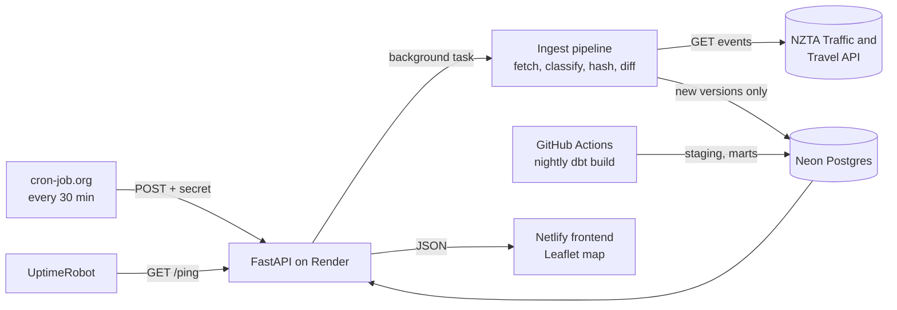

<div align="center">

# Wellington Roadworks Live

**Live closures and roadworks on Wellington's state highways, with change tracking and daily trends.**

[**View the live dashboard ↗**](https://YOUR-SITE.netlify.app/)

[](https://github.com/DarioDang/wlg-traffic-management-dashboard/actions/workflows/dbt-nightly.yml)


</div>

---

## Why this project

The NZTA Traffic and Travel API only returns a snapshot of what is happening right now. It keeps no history, so it cannot answer questions like *what just started, what changed, what was cleared, and whose end date keeps slipping?*

This project polls the feed, stores only the **real changes**, and turns that history into a live map, an activity feed and daily trends for the Wellington region (state highways only).

## Features

- **Live map** of closures, stop/go sites, lane closures and speed restrictions, with colour-blind-safe colours and a different pin shape per type (type is never carried by colour alone).
- **What changed**: every NZTA snapshot is compared with the last stored one, so only genuine new, updated and cleared events appear.
- **Per-event change history** inside each popup.
- **Schedule timeline**, **events by highway** and **routes affected**, all following the active filters.
- **Trends** built overnight by dbt: events open per day, new vs cleared, and end dates pushed back.
- Light and dark themes, reduced-motion support, and an app-style **mobile layout** with a bottom tab bar.

## Architecture



| Layer | Tools |
|---|---|
| Ingestion | Python 3.10, `requests`, hash-based change detection |
| Storage | Neon Postgres (serverless, free tier) |
| Transformation | dbt (staging views, marts tables), nightly via GitHub Actions |
| API | FastAPI on Render (free tier) |
| Scheduling and uptime | cron-job.org, UptimeRobot |
| Frontend | Vanilla JS, Leaflet, MapTiler tiles, esbuild, Netlify |
| Tests | pytest, dbt data tests |

## Design decisions

- **Change detection by content hash.** Each event gets a `content_hash`; a new version row is written only when the hash changes. NZTA's geometry detail alternates between snapshots, so geometry is reduced to its rounded start and end points before hashing. This cut stored versions from about 55 per day to about 16.
- **Safe disappearance handling.** Events missing from the feed are marked `in_feed = false`, and an empty feed is refused rather than marking every event as gone.
- **Polling every 30 minutes, not 5.** It lets Neon scale to zero between runs and keeps the project inside the free-tier compute budget.
- **No-database health ping.** UptimeRobot hits `/ping`, which never touches the database, so monitoring does not keep Neon awake.
- **Retries for a flaky upstream.** The NZTA fetch retries connection errors, timeouts and 5xx responses with backoff before a run is recorded as failed.
- **Retention.** A dbt macro deletes superseded event versions older than 90 days after a green nightly build, while the incremental `fct_event_history` keeps the long-term record.
- **Secured trigger.** The ingest endpoint requires an `X-Cron-Secret` header, compared with `hmac.compare_digest`.

## API

| Endpoint | Purpose |
|---|---|
| `GET /api/events` | Current events with coordinates, route and sections |
| `GET /api/changes?hours=` | New, updated and cleared events in a time window |
| `GET /api/events/{id}/history` | Stored versions and diffs for one event |
| `GET /api/trends?days=` | Daily activity from the dbt marts |
| `GET /api/insights` | Summary insights such as extended end dates |
| `GET /api/stats` | Headline counts |
| `GET /api/health` | Data freshness and recent ingest status |
| `GET /ping` | Lightweight uptime check (no database) |
| `POST /api/trigger/ingest` | Starts an ingest run (secret required) |

## Repository layout

```
api/        FastAPI app and settings
pipeline/   fetch, classify, geometry, hashing and ingest
dbt/        staging and marts models, macros, tests
frontend/   Leaflet dashboard (esbuild, vanilla JS)
tests/      pytest suite
notebook/   API exploration
.github/    nightly dbt workflow
```

## Run it locally

```bash
# 1. Python environment
python3.10 -m venv wlg-traffic && source wlg-traffic/bin/activate
pip install -r requirements.txt

# 2. Configuration: create .env in the repo root
#    NEON_DATABASE_URL=postgresql://...
#    CRON_SECRET=choose-a-long-random-string
#    ALLOWED_ORIGINS=http://localhost:3000

# 3. Tests
python -m pytest -q

# 4. API
uvicorn api.main:app --reload

# 5. dbt models
eval "$(python dbt/env_from_url.py NEON_DATABASE_URL)"
cd dbt && dbt build --profiles-dir .

# 6. Frontend
cd frontend && npm install && npm run build
```

Set `API_BASE` and the MapTiler key in `frontend/src/config.js` before building.

## Known limits

- The NZTA API is snapshot-only, so history starts from the day polling began.
- Only Wellington-region state highways are covered; local roads are not in the feed.
- The free API host sleeps when idle, so the first load after a quiet period can take up to a minute.

## Data

Road event data comes from the [NZTA Traffic and Travel API](https://trafficnz.info/). Map tiles © MapTiler © OpenStreetMap contributors.

## Roadmap

- Pipeline health panel from `ingest_runs`
- Shareable links that keep filters and the selected event
- Alerts for new closures on a chosen highway

---

<div align="center">

<a href="https://www.linkedin.com/in/dario-dang-89049020a/"></a>
&nbsp;&nbsp;&nbsp;
<a href="https://dariodang.github.io/"></a>

**Dario Dang** · Data Scientist

© 2026 Dario Dang. All rights reserved.

</div>